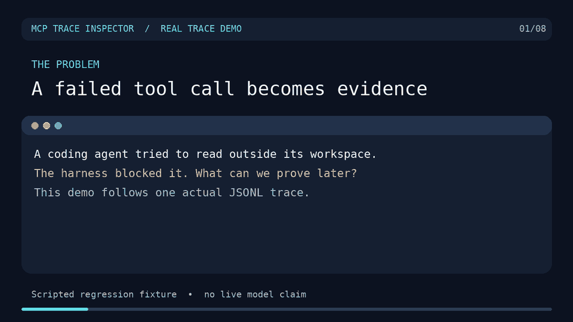

# SpanHound

<!-- mcp-name: io.github.abhishekash/spanhound -->

[](https://github.com/abhishekash/spanhound/actions/workflows/ci.yml) [](https://pypi.org/project/spanhound/) [](LICENSE)

**Inspect recorded agent-run failures and approvals from local trace files.**
SpanHound (formerly mcp-trace-inspector) is a read-only stdio MCP server for inspecting local
agent-run traces, including tool failures, approval decisions, and changes
between runs. It reads JSONL spans and OTLP JSON exports as described in the
[user guide](docs/user-guide.md), including traces from
[agent-harness](https://github.com/abhishekash/agent-harness).

<p align="center">
  <a href="docs/media/shell-root-escape-demo.mp4">
    
  </a>
</p>

**Demo:** [Watch the full 48-second video](docs/media/shell-root-escape-demo.mp4) · [Read the reproducible story](docs/shell-boundary-story.md). This is a scripted regression trace, not a live-model benchmark.

The project's concrete origin was a shell-boundary regression: the harness blocked
`cat ../outside.txt`, but the old trace recorded only that `run_shell` was
called, not the returned diagnostic. SpanHound and the harness now preserve and
query that bounded error.

## Try the included trace

```bash
git clone https://github.com/abhishekash/spanhound.git
cd spanhound
uvx --from . spanhound --trace-dir examples --check
```

`--check` prints JSON with the trace directory, span count, and recent run
summaries, then exits. It also reports a missing directory or malformed complete
JSONL or OTLP JSON record. To ask questions through MCP, connect a client using the
[configuration below](#client-configuration).

To try an OTLP JSON export, run the same command with `--trace-dir tests/fixtures`.
The [sample export](tests/fixtures/otlp_trace.json) includes a model call, token
usage, a tool call, and an exception.

## Where it fits

Use this when your agent already writes the [supported JSONL span format or OTLP JSON export](docs/user-guide.md#requirements)
and you want an MCP client to inspect those files without setting up a trace
backend. Its focused queries include recorded approval decisions, bounded
failure diagnostics, and comparisons between selected runs.

[MCP Agent Trace Inspector](https://github.com/dbsectrainer/mcp-agent-trace-inspector)
records steps into a local SQLite database and provides a dashboard and
exports. Use it when you need trace capture. This project reads trace files
written by an existing producer, including agent-harness; it does not record
the agent's actions itself.

For traces stored in Jaeger, Tempo, or Traceloop, use a backend-connected tool
such as [OpenTelemetry MCP Server](https://github.com/traceloop/opentelemetry-mcp-server).
For standard OTLP traces with a local receiver, see
[otel-mcp](https://github.com/moondef/otel-mcp). For a trace UI, instrumentation,
and evaluations, see [Phoenix](https://github.com/Arize-ai/phoenix).
This project reads saved OTLP/JSON trace exports. It does not receive live OTLP
traffic or read backend-specific JSON exports.

## AI-native use cases

| Question during an agent run | MCP tool | Evidence returned |
|---|---|---|
| "Why did yesterday's run stall?" | `list_runs` → `slowest_spans` | Run IDs and the longest model or tool spans. |
| "Did the agent act after I denied the write?" | `approval_log` → `span_tree` | The recorded decision and subsequent execution path. |
| "How many model tokens did this run use?" | `token_usage` → `span_tree` | Run-level usage totals and the span tree for context. |
| "Which tool is failing or timing out?" | `failure_report` / `tool_stats` | Redacted diagnostics, error rates, denials, and p95 latency. |
| "Who/what was allowed to act?" | `security_audit` | Caller, tenant, server provenance, risk, and missing-evidence findings. |
| "What is happening in the run right now?" | `recent_activity` | Cursor-based polling of newly written spans. |
| "Did this model/version regress?" | `compare_runs` | Cost, latency, tokens, tool calls, and failure deltas. |

The tools read stored traces and can poll files being written, but they do not push events or infer intent from the final answer. Start with the [installation and user guide](docs/user-guide.md), then see the [real trace fixture](examples/example_trace.jsonl) and the [tool descriptions](src/mcp_trace/server.py) for the query contract.

## Install & run

```bash
uvx spanhound --trace-dir ./traces
# or, for local development:
git clone https://github.com/abhishekash/spanhound
cd spanhound
uvx --from . spanhound --trace-dir ./traces
```

If you previously ran `uvx mcp-trace-inspector`, change that command to
`uvx spanhound` to receive this release. The old PyPI distribution stays at
`0.3.1`; the new package retains its Python import paths and command aliases
for clients that install `spanhound` explicitly.

## Client configuration

**Claude Desktop** (`claude_desktop_config.json`):

```json
{
  "mcpServers": {
    "agent-traces": {
      "command": "uvx",
      "args": ["spanhound", "--trace-dir", "/path/to/traces"]
    }
  }
}
```

**pi** (`~/.pi/agent/settings.json`):

```json
{
  "mcpServers": {
    "agent-traces": {
      "command": "uvx",
      "args": ["spanhound", "--trace-dir", "/path/to/traces"]
    }
  }
}
```

**agent-harness** (mounted as gated tools):

```bash
harness run "Why was my last run slow?" --mcp "uvx spanhound --trace-dir ./traces"
```

## Tools

| Tool | Use it when |
|---|---|
| `list_runs` | Starting out — recent runs with task, model, duration, cost, decision counts |
| `run_summary` | One run at a glance (accepts trace-id prefix) |
| `span_tree` | "What did the agent actually do?" — nested shape of the run |
| `slowest_spans` | "Why was it slow?" — top-k spans by duration |
| `approval_log` | HITL audit — every approve/deny/**edit**, who decided, and *the rationale* |
| `token_usage` | Cost questions — aggregated across runs or per-run |
| `search_spans` | Find spans by tool name, file path, "denied", … |
| `failure_report` | Find actionable, bounded, redacted errors and failed tool calls. |
| `tool_stats` | Rank tools by volume, error rate, denials, and latency. |
| `security_audit` | Audit caller identity, tenant, server provenance, risk, and approval evidence. |
| `recent_activity` | Poll new spans with a cursor while a run is active. |
| `compare_runs` | Compare selected traces for regressions across models or versions. |

Tool descriptions are written as prompts (when-to-use, not just what-it-does) — descriptions are the interface for agent-called tools.

## Example session (real fixture trace)

```
> list_runs
[{ "trace_id": "f920798dd2558fcb84f9977736432a8b", "task": "Summarize the workspace's notes…",
   "tool_calls": 4, "human_decisions": 2, "stopped_reason": "completed" }]

> approval_log
[{ "tool": "write_file", "decision": "approve", "approver": "auto", … },
 { "tool": "run_shell",  "decision": "approve", "approver": "auto", … }]
```

## Design

```
traces/*.jsonl ──┐
traces/*.json  ──┴─▶ mcp_trace.core (local query functions)
                          │
                   mcp_trace.server (MCP adapter)
                          │
                    stdio (JSON-RPC)
```

- **core/server split**: all logic is pure functions over parsed spans; the MCP layer only parses args and JSON-encodes results. Tests hit both layers.
- **trace_id prefixes**: agents fumble full 32-char hex ids; every tool accepts prefixes.
- **bounded output**: diagnostics are truncated and obvious credentials are redacted before query results leave the server.
- **honest cost totals**: `token_usage` returns `cost_known: false` and a null cost when any model span lacks a cost or marks pricing as unavailable; unknown pricing is never presented as `$0`.
- **cursor polling**: `recent_activity` makes the snapshot reader useful while a run is still writing spans.
- The demo fixture ([`examples/example_trace.jsonl`](examples/example_trace.jsonl)) is a *real* agent-harness run, not hand-written.

## Honest limitations

- stdio transport only (Streamable HTTP plus authenticated remote access is the next transport boundary)
- live polling re-reads snapshots; it is not a push subscription
- security audit can only report identity/provenance that the trace producer records
- read-only tools; trace mutation (annotations) is roadmap
- The Python query and server modules are available as `mcp_trace`; older import and command aliases remain for existing clients.

## License

MIT
